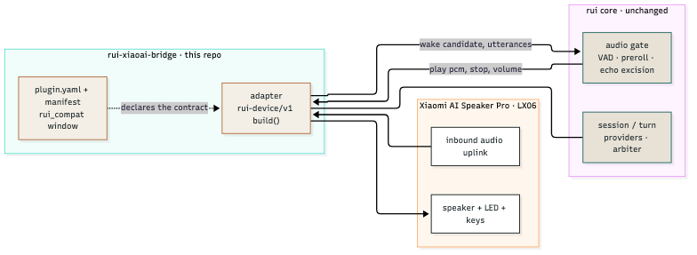

<div align="center">

# rui-xiaoai-bridge

**把小米 AI 音箱 Pro（LX06）作为 [rui](https://github.com/yes999zc/rui) 的语音卫星接入，不 fork 核心。**
一个 out-of-tree 的 Socket & Plug v1 设备插件：`plugin.yaml` + `rui-device/v1` 清单 + 进程内 adapter 包。

[](LICENSE)
[](https://github.com/yes999zc/rui-xiaoai-bridge/releases)

</div>

Latest release: https://github.com/yes999zc/rui-xiaoai-bridge/releases

---

# 中文

## 这是什么？给谁用？

LX06 自带麦克风阵列与硬件 AEC；唤醒、对话、播放由你的 rui 服务决定。rui 只通过 manifest 认识这个插件——**内核里没有一行小爱专属代码**，卸载插件就等于不支持这类设备。

适合已经跑着 rui、想把手上的小米 AI 音箱 Pro 变成语音卫星的家庭：不加设备端改动，也不 fork 核心。

```text
rui 起一个音频平面 → 插件按 rui-device/v1 提供上下行 → 说「你好小瑞」→ rui 决定这一轮 → 插件播报/报灯
```

## 架构



源文件：[`docs/assets/architecture.mmd`](docs/assets/architecture.mmd)；导出物 [`architecture.svg`](docs/assets/architecture.svg) / [`architecture.png`](docs/assets/architecture.png)。桥仓无界面，hero 即这张架构图。

| 层 | 在这个仓库里的东西 | 说明 |
|---|---|---|
| **rui 核心（不改）** | 会话/回合、供应商、唤醒仲裁、音频门限 | 用官方镜像，不补丁、不 fork |
| **本仓库（插件）** | `adapter`（`build()` 入口）、`plugin.yaml`（契约窗口）、`devices/lx06.yaml` | `rui_compat` 在插件清单里声明；越界时 loader 会拒载 |
| **设备** | LX06：入站音频上行、喇叭、LED、按键 | 设备侧 AEC 归设备 |

## 特性

- **纯 out-of-tree**：核心不内置设备实现，**本仓库是唯一来源**；插件目录挂到 `/opt/rui-plugins` 即可，没有内置回退、没有 adapter 别名（旧拼写 `adapter: xiaoai` 已不被接受，改成 `lx06`）。
- **契约优先**：设备清单遵循 `rui-device/v1`；`rui_compat` 明确声明支持的 rui 版本窗口。
- **入站设备模型**：设备把音频推到已注册的监听端口（`listen_port`），插件在音频平面内完成上下行与事件处理。
- **可观测**：`rui plug-test` 跑契约自测；设备状态与重连进 rui 的日志与轨迹。

## 快速开始

```bash
git clone https://github.com/yes999zc/rui-xiaoai-bridge.git && cd rui-xiaoai-bridge
mkdir -p /vol1/rui/plugins && cp -r src/rui_xiaoai_bridge /vol1/rui/plugins/   # 宿主插件目录
IMG=ghcr.io/yes999zc/rui:latest
docker run --rm -v /vol1/rui/plugins:/opt/rui-plugins:ro -e PYTHONPATH=/opt/rui-plugins \
  --entrypoint rui "$IMG" plug-test /opt/rui-plugins/rui_xiaoai_bridge \
  --adapter rui_xiaoai_bridge.adapter:build   # 契约自测
```

生产用 Compose：核心镜像 + `-v ./plugins:/opt/rui-plugins:ro` + `PYTHONPATH=/opt/rui-plugins` + `RUI_ADAPTER_PLUGINS=lx06=rui_xiaoai_bridge.adapter:build`，**不需要造下游镜像**。重启后在控制台「设备」页添加 LX06，或直接在 `config.yaml` 的 `devices[]` 里加一条。

## 让 AI 帮你装

把下面这段贴给任意 AI 助手：

```text
目标：用 Docker 跑起 rui + 本插件（adapter id = lx06），核心镜像 + 外置插件目录，不造下游镜像。
前置：docker compose version 通过；8080 空闲；5 GB 磁盘。
1) git clone https://github.com/yes999zc/rui.git && cd rui/examples/two-speakers   # 本示例含两台音箱的完整配置
2) git clone https://github.com/yes999zc/rui-xiaoai-bridge.git && git clone https://github.com/yes999zc/rui-dot2-bridge.git
3) mkdir -p plugins && cp -r rui-xiaoai-bridge/src/rui_xiaoai_bridge plugins/   # 需要两台都接时，把另一个桥的 src 也 cp 进来
4) 写 ./config/config.yaml（web.auth_token + devices[]，含 lx06 的 host/listen_port）
5) TLS（同 compose 里 dot2 的 tls_port 开启时必需；只接 lx06 可跳过）：原 controller 证书放 ./secrets/，没有就运行 `bash ../../scripts/make_dev_tls.sh`。自签只保证平面能起，真机信任取决于设备 CA
6) export RUI_DEVICE_TOKEN=<设备令牌>; docker compose up -d
7) 验收：/health 的 planes 里 lx06 为 running、devices 正确、device_errors=0
失败看：docker compose logs --tail=80 rui 的 config error / adapter / TLS；回滚：down 后换回上一版 image tag；TLS 失败先移走 ./secrets/ 排查
不需要自己编译 ffmpeg（镜像已内置）
```

若同一套部署里还要接 Dot 2，新设备接入可以用 rui-dot2-bridge 的 `scripts/onboard_device.py` 一条命令完成（备份 → 写入 → 校验 → 重启 → 等 connected），见 [docs/onboard-device.md](https://github.com/yes999zc/rui-dot2-bridge/blob/main/docs/onboard-device.md)。

## 兼容性与前置条件

`rui_compat` 在插件清单里声明本插件支持的 rui 窗口（同一个插件包同时服务 0.7.x 与 0.8.x 线），越界时核心会直接拒载；**当前窗口以最新 release 的说明为准**（见页首的 Latest release）。

- 安装：核心镜像 + 外置插件目录（`/vol1/rui/plugins/rui_xiaoai_bridge`），挂载 `/opt/rui-plugins` 并设 `PYTHONPATH` + `RUI_ADAPTER_PLUGINS`；**不需要造下游镜像**。Python **3.11+**。
- **设备前置条件**（第三方设备，与厂商**无官方关联**）：
  - 小米 AI 音箱 Pro（LX06），固件需已具备设备本地接口，并与 rui 主机在同一局域网；
  - 设备令牌（`RUI_DEVICE_TOKEN` 或插件配置里的 `token_env`）由你提供；
  - 监听端口（默认 `4412`）需在 rui 主机上可达；
  - 本项目只提供软件侧桥接层；设备固件与网络准备由你按设备既有能力完成。
- 唤醒与打断依赖 rui 服务端 KWS（中文），设备侧不做唤醒判定。

## 故障排查

| 现象 | 原因 | 处置 |
|---|---|---|
| 插件未被加载 | manifest 不在插件目录，或 `rui_compat` 越界 | 看 rui 启动日志里的 manifest 报错；确认 rui 版本在窗口内 |
| 设备一直离线 | 端口不可达 / 令牌不匹配 | 确认 `listen_port` 可达；`token_env` 指向的环境变量有值 |
| 能唤醒但不回话 | 音频上行或播放下行不通 | 看音频平面的 `[seg]` 与播放日志；确认设备侧 AEC 正常 |
| 与另一台音箱抢答 | 两台都在同一房间且先后被唤醒 | 分到不同房间；跨房间的播放与回合仲裁互不影响（runner 仍单会话） |
| `plug-test` 失败 | rui 版本或插件目录不对 | 在 rui 容器内跑 `rui plug-test <插件目录> --adapter rui_xiaoai_bridge.adapter:build`，按失败项逐个修 |

## 已知限制

- 未声明 `wake_words_residual` 的第三方清单不做 vendor 短语兜底。
- 两音箱默认只起第一台设备的平面，需 `multi_device: {enabled: true, max_planes: 2}`。
- 自签证书只保证平面能起，真机信任取决于设备 CA。
- LX06 的关键指标只有历史实测（唤醒 19/20、播放中打断 205.2 ms），**没有**更新的复测数据；语音指令成功率、音量、指示灯、多设备并发均**未测**。
- 设备固件差异可能影响上行音频与 AEC 行为；本项目不做设备侧干预。
- 插件在音频平面内以 in-process 方式运行（`trust=trusted` 为自声明元数据，不是沙箱）。

## 致谢

`rui-device/v1` 契约与 `plug-test` 来自 [rui](https://github.com/yes999zc/rui)；设备清单写法参考该契约的示例插件。

## License

[MIT](LICENSE)。

---

# English

## What this is, and who it is for

The LX06 brings its own microphone array and hardware AEC; wakes, dialogue and playback are decided by your rui server. rui recognises this plug only through its manifest — **the core contains no vendor-specific code**, and removing the plug means the device is simply unsupported.

It is for households that already run rui and want to turn a Xiaomi AI Speaker Pro into a voice satellite: no device-side changes and no fork of the core.

```text
rui starts an audio plane → the plug provides uplink/downlink per rui-device/v1 → "Hey Rui" → rui decides the turn → the plug speaks / lights
```

## Architecture


Source: [`docs/assets/architecture.mmd`](docs/assets/architecture.mmd); exports [`architecture.svg`](docs/assets/architecture.svg) / [`architecture.png`](docs/assets/architecture.png). A bridge has no UI, so this diagram is the hero.

| Layer | What lives here | Notes |
|---|---|---|
| **rui core (unchanged)** | Sessions/turns, providers, wake arbitration, audio gate | Official image, no patches, no fork |
| **This repo (plug)** | `adapter` (`build()` entry), `plugin.yaml` (contract window), `devices/lx06.yaml` | `rui_compat` is declared in the plug manifest; the loader refuses out-of-range versions |
| **Device** | LX06: inbound audio uplink, speaker, LED, keys | Device-side AEC stays on the device |

## Features

- **Pure out-of-tree**: the core ships no device implementation, and **this repository is the only source**. Mount the plug directory at `/opt/rui-plugins`; there is no in-tree fallback and no adapter alias (a legacy `adapter: xiaoai` is not accepted — use `lx06`).
- **Contract first**: the device manifest follows `rui-device/v1` and declares the supported rui window in `rui_compat`.
- **Inbound device model**: the device pushes audio to a registered listen port; the plug handles uplink/downlink and events inside the audio plane.
- **Observability**: `rui plug-test` runs the contract suite; device state and reconnects land in rui logs and traces.

## Quickstart

```bash
git clone https://github.com/yes999zc/rui-xiaoai-bridge.git && cd rui-xiaoai-bridge
mkdir -p /vol1/rui/plugins && cp -r src/rui_xiaoai_bridge /vol1/rui/plugins/   # host plug dir
IMG=ghcr.io/yes999zc/rui:latest
docker run --rm -v /vol1/rui/plugins:/opt/rui-plugins:ro -e PYTHONPATH=/opt/rui-plugins \
  --entrypoint rui "$IMG" plug-test /opt/rui-plugins/rui_xiaoai_bridge \
  --adapter rui_xiaoai_bridge.adapter:build   # contract self-test
```

In production use Compose: core image + `-v ./plugins:/opt/rui-plugins:ro` + `PYTHONPATH=/opt/rui-plugins` + `RUI_ADAPTER_PLUGINS=lx06=rui_xiaoai_bridge.adapter:build`; **no downstream image is needed**. Restart, then add the LX06 on the Devices page or append an entry to `devices[]`.

## Let an AI install it

Paste this:

```text
Goal: run rui + this plug (adapter id = lx06) with Docker, using the core image plus an external plug directory (no downstream image).
Preflight: docker compose version; port 8080 free; 5 GB disk.
1) git clone https://github.com/yes999zc/rui.git && cd rui/examples/two-speakers   # complete two-speaker example
2) git clone https://github.com/yes999zc/rui-xiaoai-bridge.git && git clone https://github.com/yes999zc/rui-dot2-bridge.git
3) mkdir -p plugins && cp -r rui-xiaoai-bridge/src/rui_xiaoai_bridge plugins/   # copy the other bridge's src too if you run both
4) write ./config/config.yaml (web.auth_token + devices[] with host/listen_port for lx06)
5) TLS (required only when dot2's tls_port is on in the same compose; skip for lx06-only): put the original controller cert into ./secrets/, or run `bash ../../scripts/make_dev_tls.sh`. Self-signed only proves the plane starts; the device's trusted CA decides acceptance
6) export RUI_DEVICE_TOKEN=<device token>; docker compose up -d
7) verify: /health.planes shows lx06 running, devices correct, device_errors=0
On failure: docker compose logs --tail=80 rui (config error / adapter / TLS); rollback: down and switch the image tag back; for TLS failures move ./secrets/ away first
No ffmpeg build needed (the image ships it)
```

If the same deployment also takes a Dot 2, onboarding can be done with one command via `scripts/onboard_device.py` in rui-dot2-bridge (backup → write → verify → restart → wait for connected); see [docs/onboard-device.md](https://github.com/yes999zc/rui-dot2-bridge/blob/main/docs/onboard-device.md).

## Compatibility and prerequisites

`rui_compat` in the plug manifest declares the rui window this plug loads into (the same package serves both the 0.7.x and 0.8.x lines), and the loader refuses anything out of range; **the current window is whatever the latest release says** (see the Latest release line at the top).

- Install: core image + external plug directory (`/vol1/rui/plugins/rui_xiaoai_bridge`), mounted at `/opt/rui-plugins` with `PYTHONPATH` + `RUI_ADAPTER_PLUGINS`; **no downstream image is needed**. Python **3.11+**.
- **Device prerequisites** (third-party hardware, **not affiliated with any vendor**):
  - Xiaomi AI Speaker Pro (LX06) with firmware that already exposes the device's local interface, on the same LAN as the rui host;
  - a device token (`RUI_DEVICE_TOKEN`, or the `token_env` value in the plug config) that you provide;
  - the listen port (default `4412`) reachable on the rui host;
  - this project only provides the software bridge; preparing firmware and network is up to you, using the device's existing capabilities.
- Wake and barge-in rely on rui's server-side KWS (Chinese); the device makes no wake decision.

## Troubleshooting

| Symptom | Cause | Fix |
|---|---|---|
| Plug never loads | Manifest missing from the plug dir, or `rui_compat` out of range | Read the manifest error in rui's startup log; confirm the rui version |
| Device stays offline | Port unreachable, or token mismatch | Check the listen port and that `token_env` points at a value |
| Wakes but never answers | Uplink or playback downlink is broken | Inspect `[seg]` and playback lines in the audio plane logs; verify device AEC |
| Two speakers talk over each other | Both in the same room and woken in sequence | Put them in different rooms; cross-room playback and turn arbitration are isolated (the runner is still single-session) |
| `plug-test` fails | Wrong rui version or plug path | Run `rui plug-test <plugin-dir> --adapter rui_xiaoai_bridge.adapter:build` inside the container |

## Known limitations

- A third-party manifest without `wake_words_residual` gets no vendor-phrase backstop.
- Two speakers start one plane by default unless `multi_device: {enabled: true, max_planes: 2}` is set.
- A self-signed certificate only starts the plane; real-device trust depends on its CA.
- LX06 numbers are historical only (19/20 wake, 205.2 ms barge-in) with **no** newer re-measurement; voice-command success rate, volume, LED and concurrency are **untested**.
- Firmware differences can change uplink audio and AEC behaviour; this project does not touch the device.
- The plug runs in-process inside the audio plane (`trust=trusted` is self-asserted metadata, not a sandbox).

## Credits

The `rui-device/v1` contract and `plug-test` come from [rui](https://github.com/yes999zc/rui); the manifest follows the example plug in that contract.

## License

[MIT](LICENSE).
